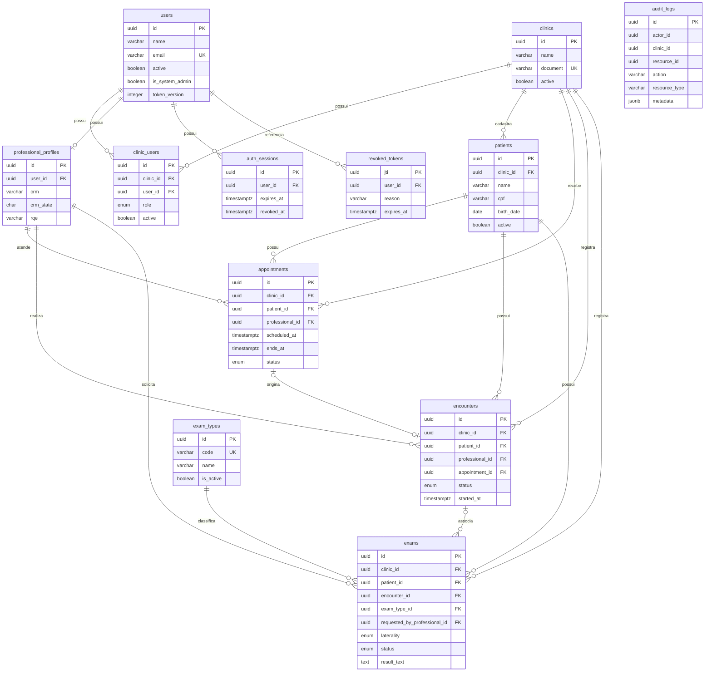
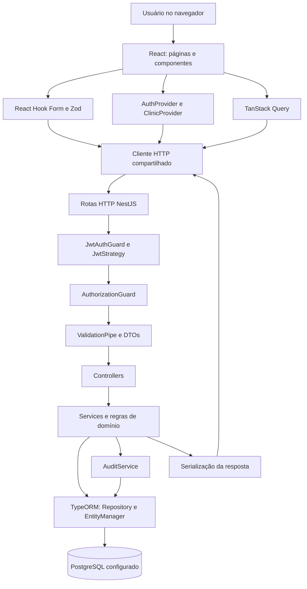

# MedVita Care — auditoria técnica para o capítulo 4: Resultados e Discussões

Data da auditoria: 08/11/2026.

Versão do código analisado: commit `72a7368`, considerando também os documentos disponíveis no workspace.

Finalidade: fornecer evidências técnicas para apoiar a redação acadêmica do capítulo de Resultados e Discussões de um TCC de Análise e Desenvolvimento de Sistemas.

> Orientação para utilização deste documento no ChatGPT: mantenha a distinção entre código implementado, resultados históricos documentados e evidências ainda não coletadas. Não transforme a existência de código em comprovação de implantação, execução de migrations, aprovação de testes ou ganhos quantitativos. Os caminhos citados são relativos à raiz do repositório MedVita Care. O conteúdo dos arquivos referenciados não acompanha automaticamente este documento.

# 4.1 Levantamento de requisitos e critérios da auditoria

## 4.1.1 Escopo e limites da análise

Foram analisados o back-end em `/api` e o front-end em `/web`, considerando o código disponível no workspace e o commit `72a7368`.

A auditoria foi exclusivamente de leitura. Durante a auditoria não foram criados, alterados, removidos ou formatados arquivos. Também não foram executados testes, builds, migrations, seeds ou consultas ao banco de dados. Arquivos de ambiente não foram consultados.

Este arquivo Markdown foi criado posteriormente, a pedido do responsável pelo projeto, para preservar o relatório. Sua criação não representa nova execução das validações descritas.

A existência de implementação no código **não comprova sua implantação nem seu funcionamento no banco atualmente utilizado**.

As classificações empregadas são:

| Status | Significado |
|---|---|
| **Implementado** | Há código correspondente à funcionalidade ou ao controle analisado. Não significa homologação em produção. |
| **Parcialmente implementado** | Há implementação, mas existem limitações de interface, contrato, cobertura ou integração. |
| **Planejado** | A documentação registra uma evolução futura, sem implementação correspondente identificada. |
| **Não identificado** | Não foi encontrada implementação no escopo analisado. |

Os requisitos abaixo foram **derivados do código**. Eles não substituem um documento de requisitos validado com os interessados no projeto.

## 4.1.2 Requisitos funcionais

| Código | Descrição evidenciada | Módulo | Status | Evidência principal |
|---|---|---|---|---|
| RF01 | Autenticar usuário por e-mail e senha | Autenticação | Implementado | `api/src/auth/auth.controller.ts`; `api/src/auth/auth.service.ts` |
| RF02 | Recuperar, renovar e encerrar sessão | Autenticação | Implementado | `api/src/auth/entities/auth-session.entity.ts`; `web/src/contexts/AuthProvider.tsx` |
| RF03 | Alterar a própria senha | Autenticação | Implementado | `api/src/auth/dto/change-password.dto.ts`; `web/src/features/auth/pages/ChangePasswordPage.tsx` |
| RF04 | Cadastrar, consultar, editar e alterar o status de usuários globais | Usuários | Implementado | `api/src/users/users.controller.ts`; `web/src/features/users/pages/UsersPage.tsx` |
| RF05 | Cadastrar, consultar, editar e ativar/desativar clínicas | Clínicas | Implementado | `api/src/clinics/clinics.controller.ts`; `web/src/features/clinics/pages/ClinicsPage.tsx` |
| RF06 | Selecionar uma clínica autorizada para operações locais | Contexto multi-clínica | Implementado | `web/src/contexts/ClinicProvider.tsx`; `web/src/features/clinics/lib/allowed-memberships.ts` |
| RF07 | Consultar vínculos e alterar papel/status de membros | Usuários por clínica | Implementado | `api/src/clinic-users/clinic-users.controller.ts`; `web/src/features/clinic-users/pages/ClinicUsersPage.tsx` |
| RF08 | Vincular usuário existente a uma clínica | Usuários por clínica | Parcialmente implementado | API permite a operação ao ADMIN; a busca de candidatos na interface está disponível somente ao System Admin |
| RF09 | Cadastrar e consultar perfil profissional associado a usuário | Profissionais | Implementado | `api/src/professionals/professionals.service.ts`; `web/src/features/professionals/components/ProfessionalForm.tsx` |
| RF10 | Gerenciar pacientes por clínica | Pacientes | Implementado | `api/src/patients/patients.service.ts`; `web/src/features/patients/pages/` |
| RF11 | Criar, consultar, reagendar e cancelar agendamentos | Agendamentos | Implementado | `api/src/appointments/appointments.controller.ts`; `web/src/features/appointments/pages/AppointmentsPage.tsx` |
| RF12 | Verificar disponibilidade e impedir sobreposição de agenda profissional | Agendamentos | Implementado | `api/src/appointments/appointments.service.ts`; `api/src/database/migrations/1793692800000-AddClinicalOperationsAndAudit.ts` |
| RF13 | Exibir agendamentos em calendário | Calendário | Implementado | `web/src/features/calendar/components/FullCalendarView.tsx`; `web/src/features/calendar/hooks/use-calendar-appointments.ts` |
| RF14 | Iniciar, preencher, concluir e cancelar atendimento | Prontuários/atendimentos | Implementado | `api/src/encounters/encounters.service.ts`; `web/src/features/medical-records/components/EncounterForm.tsx` |
| RF15 | Consultar histórico de atendimentos de paciente | Prontuários | Implementado | `EncountersService.findPatientHistory`, em `api/src/encounters/encounters.service.ts`; `web/src/features/medical-records/pages/MedicalRecordsPage.tsx` |
| RF16 | Solicitar exame, registrar resultado descritivo, concluir e cancelar | Exames | Implementado | `api/src/exams/exams.service.ts`; `web/src/features/exams/components/` |
| RF17 | Registrar eventos e consultar trilha de auditoria | Auditoria | Parcialmente implementado | API implementada; não foi identificada tela própria de auditoria |
| RF18 | Exibir próximos atendimentos e indicadores no dashboard | Dashboard | Parcialmente implementado | Há atalhos e placeholder de agenda, sem consulta agregada em `web/src/pages/DashboardPage.tsx` |
| RF19 | Trabalhar com confirmação e ausência de agendamento | Agendamentos | Parcialmente implementado | `CONFIRMED` e `NO_SHOW` existem no enum; não foram identificados endpoints específicos para essas transições |
| RF20 | Anexar arquivos a exames | Exames | Planejado | Pendência registrada em `web/src/features/exams/README.md`; endpoints não identificados |
| RF21 | Convidar usuários ou recuperar senha por e-mail | Usuários/autenticação | Não identificado | Ausência de operações correspondentes nos controllers analisados |

Referências centrais: `web/src/App.tsx`, `web/src/features/users/README.md` e `web/src/pages/DashboardPage.tsx`.

## 4.1.3 Requisitos não funcionais evidenciados

| Código | Descrição derivada do código | Status | Evidência e limite |
|---|---|---|---|
| RNF01 | Organizar o back-end em módulos de domínio | Implementado | `api/src/app.module.ts` e arquivos `*.module.ts` |
| RNF02 | Utilizar contratos HTTP tipados e validação de entrada | Implementado | DTOs, `ValidationPipe`, cliente HTTP e tipos TypeScript |
| RNF03 | Autenticar e autorizar operações por usuário e vínculo | Implementado | Guards globais, estratégia JWT e verificações nos services |
| RNF04 | Isolar consultas por clínica e escopo profissional | Implementado, com diferenças entre módulos | Filtros nos services e chaves de cache; não equivale a isolamento físico de bancos |
| RNF05 | Preservar integridade em operações concorrentes | Implementado nas operações identificadas | Transações, bloqueios pessimistas e exclusão de períodos de agenda |
| RNF06 | Registrar operações relevantes sem incluir conteúdo clínico desnecessário | Parcialmente implementado | `AuditService` e chamadas explícitas; cobertura não uniforme em todos os módulos |
| RNF07 | Adaptar a interface a smartphones e desktop | Parcialmente comprovado | Classes responsivas e relatos de testes; não houve nova inspeção visual em execução nesta auditoria |
| RNF08 | Oferecer acessibilidade por labels, foco e diálogos | Parcialmente implementado | Componentes semânticos e atributos ARIA; não foi identificada avaliação integral de acessibilidade |
| RNF09 | Reduzir perda de dados ao sair de formulários | Implementado nos formulários que utilizam a proteção | `web/src/features/medical-records/hooks/use-unsaved-clinical-changes.ts` e componentes consumidores |
| RNF10 | Versionar alterações do esquema de dados | Implementado no código | Cinco migrations encontradas; aplicação no banco não verificada |
| RNF11 | Possuir testes automatizados reproduzíveis | Parcialmente implementado | Ferramentas declaradas, mas arquivos de testes não encontrados |
| RNF12 | Comprovar desempenho, capacidade e disponibilidade | Não identificado | Não foram encontrados resultados atuais de carga, disponibilidade ou recuperação |

Não foram identificadas, no código consultado, implementações de autenticação multifator ou limitação de tentativas por mecanismo de rate limiting. Isso indica uma lacuna de evidência, não uma conclusão sobre configurações externas ao repositório.

Fontes: `api/src/main.ts`, `api/src/auth/auth.module.ts`, `web/src/lib/query-client.ts` e `web/src/features/medical-records/hooks/use-unsaved-clinical-changes.ts`.

## 4.1.4 Regras de negócio e validações

| Regra | Comportamento observado | Evidência |
|---|---|---|
| RN01 — Conta global | O usuário é cadastrado uma vez e pode possuir vários vínculos com clínicas | `api/src/users/entities/user.entity.ts`; `api/src/clinic-users/entities/clinic-user.entity.ts` |
| RN02 — Perfil único | Um usuário não pode possuir múltiplos perfis profissionais | `professional_profiles.user_id` único em `api/src/professionals/entities/professional-profile.entity.ts` |
| RN03 — Administrador da clínica | Deve existir pelo menos um vínculo ADMIN ativo; determinadas alterações do último administrador são recusadas | `ClinicUsersService.updateRole/updateActive`, em `api/src/clinic-users/clinic-users.service.ts` |
| RN04 — Primeiro vínculo | O primeiro vínculo ativo da clínica deve ser ADMIN | `ClinicUsersService.create` |
| RN05 — Elegibilidade profissional | Cadastro profissional exige usuário e vínculo de oftalmologista elegíveis; CRM/UF e unicidade são verificados | `api/src/professionals/professionals.service.ts`; `api/src/professionals/professional-registration.util.ts` |
| RN06 — CPF | CPF opcional é normalizado e validado; sua unicidade é por clínica quando não nulo | `api/src/patients/utils/cpf.util.ts`; `api/src/patients/patients.service.ts`; entidade Patient |
| RN07 — Nascimento | Data deve ser válida e não futura | `api/src/patients/utils/date-only.util.ts`; `PatientsService.validateBirthDate` |
| RN08 — Documento da clínica | É normalizado, mas não há validação de dígitos verificadores de CNPJ | `api/src/common/utils/normalize-document.util.ts`; `api/src/clinics/clinics.service.ts` |
| RN09 — Atualização da clínica | O DTO de edição não admite documento, CEP ou cidade | `api/src/clinics/dto/update-clinic.dto.ts` |
| RN10 — Agenda | Criação/reagendamento exigem período futuro e duração de 5 a 480 minutos | `api/src/appointments/dto/`; `AppointmentsService.buildPeriod` |
| RN11 — Sobreposição | Conflitos são verificados pelo profissional, inclusive entre clínicas | `AppointmentsService.findConflict`; constraint `EX_appointments_professional_period` |
| RN12 — Atendimento | Só o profissional designado pode iniciar; agendamento deve estar em estado permitido e não possuir atendimento | `EncountersService.start`, em `api/src/encounters/encounters.service.ts` |
| RN13 — Conclusão clínica | Queixa principal, avaliação clínica e plano são exigidos para concluir | `EncountersService.assertCompletionData` |
| RN14 — Registro clínico finalizado | Alterações são restritas a atendimentos em andamento | `EncountersService.assertInProgress` |
| RN15 — Exame | Solicitante e data da solicitação são definidos pelo servidor | `ExamsService.create`, em `api/src/exams/exams.service.ts` |
| RN16 — Associação de exame | Paciente, clínica, atendimento e solicitante devem ser compatíveis | `ExamsService.create`; FKs compostas da migration de Exames |
| RN17 — Resultado de exame | Resultado não vazio, até 12.000 caracteres; realização entre solicitação e momento atual | `api/src/exams/dto/exam.dto.ts`; `ExamsService.result` |
| RN18 — Estados de exame | Resultado leva a IN_PROGRESS; conclusão é separada; COMPLETED e CANCELLED são imutáveis | `ExamsService.result/complete/cancel` |
| RN19 — Revogação | Alterações de e-mail, privilégio, status ou senha incrementam tokenVersion conforme a operação | `api/src/users/user.service.ts` |
| RN20 — Senha | Cadastro exige comprimento de 8 a 255 caracteres; armazenamento utiliza bcrypt | `api/src/users/dto/create-user.dto.ts`; `api/src/common/hashing/bcrypt.service.ts` |

Essas validações não comprovam autenticidade cadastral perante órgãos externos. Por exemplo, normalizar CRM ou CNPJ não corresponde a consultar um registro oficial.

# 4.2 Modelagem do sistema e banco de dados

## 4.2.1 Entidades encontradas

Foram encontrados **13 arquivos com sufixo `.entity.ts`**, dos quais:

- **12 representam entidades persistentes**, com `@Entity`;
- `BaseEntity` é uma classe abstrata compartilhada, sem tabela própria.

Nas entidades que herdam de `BaseEntity`, existem `id` UUID gerado, `created_at` e `updated_at`. Fonte: `api/src/common/entities/base.entity.ts`.

Na tabela seguinte, “opcional” indica coluna declarada como anulável. A ausência de NULL no banco não impede, por si só, uma string vazia.

| Entidade / tabela | Atributos principais e obrigatoriedade | Chaves e restrições | Arquivo |
|---|---|---|---|
| **User / users** | Obrigatórios: nome, e-mail, hash de senha, ativo, administrador global e versão de token | PK id; e-mail único; hash marcado com @Exclude | `api/src/users/entities/user.entity.ts` |
| **Clinic / clinics** | Obrigatórios: nome, documento, ativo. Opcionais: telefone, e-mail e endereço | PK id; documento único | `api/src/clinics/entities/clinic.entity.ts` |
| **ClinicUser / clinic_users** | Clínica, usuário, papel e ativo obrigatórios | PK id; FKs de clínica/usuário; par (clinic_id,user_id) único | `api/src/clinic-users/entities/clinic-user.entity.ts` |
| **ProfessionalProfile / professional_profiles** | Usuário, CRM, UF e especialidade obrigatórios; RQE opcional | PK id; usuário único; (crm,crm_state) único | `api/src/professionals/entities/professional-profile.entity.ts` |
| **Patient / patients** | Clínica, nome, nascimento e ativo obrigatórios; CPF, sexo, contato e endereço opcionais | PK id; FK clínica; índice único parcial (clinic_id,cpf) quando CPF não nulo | `api/src/patients/entities/patient.entity.ts` |
| **Appointment / appointments** | Clínica, paciente, profissional, início, fim, duração e status obrigatórios; motivo, observações e cancelamento opcionais | PK id; FKs de clínica, paciente e profissional | `api/src/appointments/entities/appointment.entity.ts` |
| **Encounter / encounters** | Clínica, paciente, profissional, status e início obrigatórios; agendamento, término e campos clínicos opcionais no esquema | PK id; FKs de clínica/paciente/profissional/agendamento; agendamento único quando informado | `api/src/encounters/entities/encounter.entity.ts` |
| **ExamType / exam_types** | Código, nome e ativo obrigatórios; descrição opcional | PK id; código único | `api/src/exams/entities/exam-type.entity.ts` |
| **Exam / exams** | Clínica, paciente, tipo, solicitante, lateralidade, status e solicitação obrigatórios; atendimento, resultado e datas posteriores opcionais conforme estado | PK id; FKs simples e compostas; exclusão RESTRICT | `api/src/exams/entities/exam.entity.ts` |
| **AuthSession / auth_sessions** | ID, usuário, hash/JTI de renovação, expiração e timestamps obrigatórios; revogação opcional | PK id, sem geração automática declarada na entidade; FK usuário com CASCADE; índice por usuário | `api/src/auth/entities/auth-session.entity.ts` |
| **RevokedToken / revoked_tokens** | JTI, usuário, motivo, expiração e criação obrigatórios | PK jti; FK usuário com CASCADE; índice por usuário | `api/src/auth/entities/revoked-token.entity.ts` |
| **AuditLog / audit_logs** | Ação, tipo de recurso, metadados e criação obrigatórios; ator, clínica e recurso opcionais | PK id; índices por clínica/data e recurso. IDs de ator/clínica/recurso não possuem FKs declaradas | `api/src/audit/entities/audit-log.entity.ts` |

O endereço de Clinic e Patient contém `zip_code`, `street`, `number`, `complement`, `neighborhood`, `city` e `state`.

Encounter contém queixa principal, anamnese, acuidade visual direita/esquerda, pressão intraocular direita/esquerda, avaliação clínica, plano e observações. Pressões usam `numeric(5,2)`; acuidade usa `varchar(50)`.

## 4.2.2 Relacionamentos e cardinalidades

| Relacionamento | Cardinalidade definida |
|---|---|
| Usuário → vínculos | 1:N |
| Clínica → vínculos | 1:N |
| Usuário ↔ clínica | N:M resolvido por ClinicUser |
| Usuário → perfil profissional | 1:0..1 |
| Clínica → pacientes | 1:N |
| Clínica/paciente/profissional → agendamentos | Cada entidade possui relação 1:N com Appointment |
| Clínica/paciente/profissional → atendimentos | Cada entidade possui relação 1:N com Encounter |
| Agendamento ↔ atendimento | 0..1:0..1 no esquema; a criação pela API exige agendamento |
| Clínica/paciente/tipo/solicitante → exames | Relações 1:N |
| Atendimento → exames | 1:N; o exame pode não ter atendimento |
| Usuário → sessões/tokens revogados | 1:N |

Não existe FK direta entre ProfessionalProfile e Clinic. A elegibilidade do profissional na clínica é obtida pelo usuário e seus vínculos.

### Diagrama ER

O diagrama representa o esquema definido no código, **não uma extração do banco em execução**. As FKs compostas de Exames estão detalhadas após o diagrama.

AuditLog permanece sem ligações referenciais no diagrama porque seus identificadores são colunas comuns, sem relacionamento TypeORM ou FK nas migrations consultadas.

## 4.2.3 Migrations identificadas

Diretório: `api/src/database/migrations/`.

| Migration | Conteúdo efetivamente encontrado |
|---|---|
| `1792265281000-EnableUuidOsspExtension.ts` | Cria a extensão uuid-ossp |
| `1792265281923-AddIsSystemAdminToUsers.ts` | Apesar do nome, cria sete tabelas-base: users, clinics, clinic_users, professional_profiles, patients, appointments e encounters; enums, índices e FKs |
| `1793210400000-AddAuthSessionsAndTokenRevocation.ts` | Acrescenta token_version; cria sessões e tokens revogados, com índices e FKs |
| `1793692800000-AddClinicalOperationsAndAudit.ts` | Acrescenta fim/cancelamento de agendamentos, regras de período, exclusão GiST, campos clínicos, índices e audit_logs |
| `1794096000000-AddExams.ts` | Cria exam_types/exams, catálogo inicial, enums, índices, checks e FKs compostas |

**Constatação documental relevante:** `api/docs/EXAMS.md` afirma que faltaria criação inicial das tabelas nas migrations históricas. Essa afirmação não corresponde ao conteúdo atual de `1792265281923-AddIsSystemAdminToUsers.ts`, que contém a estrutura-base. A documentação precisa ser revisada; não foi alterada nesta auditoria.

## 4.2.4 Índices, integridade e exclusão

Além das unicidades das entidades, foram identificados nas migrations:

- Índices de sessões/tokens por usuário e de tokens por expiração.
- Agendamentos por clínica/data.
- Atendimentos por clínica/data e paciente/data.
- Auditoria por clínica/data, recurso e ator/data.
- Exames por clínica/solicitante/data, clínica/paciente/data, clínica/status/data e atendimento.
- Índices únicos auxiliares em `patients(id,clinic_id)` e `encounters(id,clinic_id,patient_id,professional_id)`.

As FKs compostas de Exames validam:

1. `(patient_id,clinic_id)` contra Patient;
2. `(encounter_id,clinic_id,patient_id,requested_by_professional_id)` contra Encounter.

A migration clínica define:

- início do agendamento anterior ao término;
- duração entre 5 e 480 minutos;
- exclusão de intervalos sobrepostos do mesmo profissional nos estados abertos considerados.

Exames possuem checks de comprimento, realização posterior à solicitação e coerência entre estado, resultado e datas de conclusão/cancelamento.

As FKs clínicas da estrutura-base utilizam `ON DELETE NO ACTION`; Exames utiliza `RESTRICT`. Sessões e tokens revogados utilizam `CASCADE` em relação ao usuário. Não foram encontrados endpoints de exclusão física nos controllers analisados.

Fontes: migrations citadas e `api/src/database/connection-options.ts`.

## 4.2.5 Estrutura definida versus aplicada

| Aspecto | Conclusão possível |
|---|---|
| Tabelas e relacionamentos previstos | Comprovados pelas entidades e migrations |
| Sincronização automática | Desabilitada no código |
| Execução automática de migrations | Desabilitada na configuração de conexão |
| Banco selecionado, tabelas existentes e dados armazenados | Não verificados |
| Migrations efetivamente aplicadas | Não verificadas |
| FKs, índices e extensões ativos no ambiente | Não verificados |

Não é possível afirmar, com esta auditoria, que as 12 tabelas existem no banco utilizado pelo projeto.

# 4.3 Casos de uso, atores e permissões

## 4.3.1 Atores identificados

- **Visitante:** pode iniciar autenticação; renovação depende de sessão válida.
- **Usuário autenticado:** pode encerrar sessão, alterar a própria senha e consultar seus vínculos.
- **Administrador do sistema:** identificado por isSystemAdmin.
- **Administrador da clínica:** vínculo ADMIN.
- **Recepcionista:** vínculo RECEPTIONIST.
- **Oftalmologista:** vínculo OPHTHALMOLOGIST.

Um mesmo usuário pode exercer papéis diferentes em clínicas distintas. O administrador do sistema não deve ser modelado como sinônimo de ADMIN local.

Fontes: `api/src/clinic-users/entities/clinic-user.entity.ts`, `api/src/auth/types/jwt-payload.type.ts`, `api/src/auth/guards/authorization.guard.ts` e `api/src/auth/strategies/jwt.strategy.ts`.

## 4.3.2 Matriz ator versus caso de uso

A coluna “System Admin” considera **somente o privilégio global, sem vínculo clínico adicional**.

Legenda: **Sim** = comprovado; **Próprio** = limitado ao usuário/profissional; **Clínica** = limitado ao vínculo; **Não** = não autorizado apenas por esse papel.

| Caso de uso | System Admin | ADMIN local | Recepcionista | Oftalmologista |
|---|---|---|---|---|
| Gerenciar usuários globais | Sim | Não | Não | Não |
| Listar/cadastrar clínicas globalmente | Sim | Não | Não | Não |
| Consultar clínica autorizada | Sim | Clínica | Clínica | Clínica |
| Editar clínica | Sim | Clínica | Não | Não |
| Ativar/desativar clínica | Sim | Não | Não | Não |
| Consultar equipe | Sim | Clínica | Clínica | Clínica |
| Alterar papel/status de vínculo | Sim | Clínica | Não | Não |
| Criar vínculo pela API | Sim | Clínica | Não | Não |
| Localizar candidato global na interface | Sim | Não | Não | Não |
| Consultar perfis profissionais | Sim, elegíveis no escopo | Clínica | Clínica | Próprio |
| Cadastrar/editar perfil profissional | Sim | Clínica | Não | Não |
| Consultar pacientes | Não sem vínculo adicional | Clínica | Clínica | Clínica |
| Criar/editar paciente | Não sem vínculo adicional | Clínica | Clínica | Não |
| Alterar status de paciente | Não sem vínculo adicional | Clínica | Não | Não |
| Criar/reagendar/cancelar agendamento | Não sem vínculo adicional | Clínica | Clínica | Não |
| Consultar agenda/disponibilidade | Não sem vínculo adicional | Clínica | Clínica | Próprio |
| Iniciar/editar/concluir atendimento | Não sem vínculo adicional | Não | Não | Próprio |
| Consultar histórico do paciente na clínica | Não sem vínculo adicional | Não | Não | Clínica |
| Gerenciar exames | Não sem vínculo adicional | Não | Não | Próprio |
| Consultar auditoria | Não sem vínculo ADMIN adicional | Clínica | Não | Não |
| Alterar a própria senha | Próprio | Próprio | Próprio | Próprio |

As permissões resultam da combinação de controller, guard e service, não apenas dos decorators.

### Particularidades comprovadas

1. **Bypass do guard global não significa bypass de todos os services.** Pacientes, Agendamentos, Prontuários, Exames e Auditoria realizam verificações adicionais.
2. **Profissionais admite System Admin explicitamente no service**, além do ADMIN local.
3. **Histórico e detalhe de atendimento têm escopos diferentes:** o histórico filtra clínica/paciente; listagem pessoal e detalhe filtram também o profissional.
4. **ADMIN local pode criar vínculo pela API**, mas a interface não possui busca local autorizada de candidatos; esse caminho depende do administrador global.
5. **Prévias administrativas de Prontuários/Exames são demonstrativas**, exclusivas de desenvolvimento, sem conceder acesso clínico real.

Fontes: `PatientsService.assertClinicRole`, `AppointmentsService.assertClinicRole`, `ProfessionalsService.applyReadScope`, `EncountersService.authorizedQuery/findPatientHistory`, `ExamsService.authorize` e `AuditService.assertClinicAdmin`, nos respectivos services em `api/src/`.

Não foram identificadas permissões apenas inferidas necessárias à matriz. Autorizações que dependeriam de configuração externa ou mudança futura foram excluídas.

## 4.3.3 Descrição para construir o diagrama UML

Pode-se utilizar **Usuário autenticado** como ator geral e representar os papéis contextuais como especializações. Uma pessoa pode assumir mais de um papel; eles não são categorias exclusivas de cadastro.

Distribuição sugerida dos casos de uso:

- **Administrador do sistema:** gerenciar contas globais; gerenciar clínicas; gerenciar vínculos; gerenciar perfis profissionais conforme autorização.
- **ADMIN local:** administrar dados da clínica; gerenciar equipe; gerenciar pacientes e agendamentos; consultar auditoria.
- **Recepcionista:** consultar clínica/equipe/profissionais; cadastrar pacientes; administrar agendamentos.
- **Oftalmologista:** consultar agenda própria; iniciar atendimento; registrar dados clínicos; concluir/cancelar atendimento; consultar histórico; solicitar exame; registrar resultado; concluir/cancelar exame.

Autenticação deve ser tratada como **precondição** das operações protegidas, evitando representar um novo login obrigatório em cada execução de caso de uso.

Exemplo textual:

**UC — Concluir atendimento**

- Ator: oftalmologista responsável.
- Precondições: sessão válida, vínculo autorizado, atendimento próprio em andamento.
- Fluxo: preencher dados → validar queixa/avaliação/plano → solicitar conclusão → persistir mudanças e auditoria na transação.
- Pós-condição prevista: atendimento e agendamento associados concluídos.
- Alternativas: dados insuficientes, estado incompatível, acesso negado ou falha de persistência/auditoria.

Fonte: `api/src/encounters/encounters.service.ts`.

# 4.4 Arquitetura e fluxo de requisição

## 4.4.1 Classificação arquitetural

O back-end corresponde a um **monólito modular NestJS**: um AppModule integra os módulos de domínio e uma inicialização cria a aplicação.

O front-end é uma SPA React separada, consumidora da API HTTP. Não foram identificados, no código analisado, serviços independentes de domínio, mensageria ou comunicação distribuída que caracterizem uma arquitetura de microsserviços.

Fontes: `api/src/app.module.ts`, `api/src/main.ts` e `web/src/main.tsx`.

## 4.4.2 Responsabilidades das camadas

| Componente | Responsabilidade observada | Exemplos |
|---|---|---|
| Módulos NestJS | Agrupar providers, controllers, entidades e dependências | `api/src/exams/exams.module.ts`, `api/src/patients/patients.module.ts` |
| Controllers | Definir métodos HTTP, rotas, parâmetros e metadados de autorização | Arquivos `*.controller.ts` |
| DTOs | Validar e transformar entrada | class-validator, class-transformer e diretórios dto |
| Services | Aplicar regras, escopos, transações e auditoria | Arquivos `*.service.ts` |
| Repositories | Consultar e persistir entidades | @InjectRepository, Repository e EntityManager |
| Entities | Mapear tabelas, colunas e relações | Arquivos `*.entity.ts` |
| Guards | Validar autenticação e autorização | JwtAuthGuard, AuthorizationGuard |
| Interceptor | Aplicar serialização e exclusões | ClassSerializerInterceptor em `api/src/main.ts` |
| Cliente HTTP React | Padronizar Fetch, erros e renovação após 401 | `web/src/api/http-client.ts` |
| Hooks Query | Consultar, armazenar temporariamente e invalidar dados | Hooks das features |
| Contextos React | Compartilhar usuário, sessão e clínica ativa | AuthProvider e ClinicProvider |

Não foi identificada uma camada própria de repositories de domínio: os services utilizam diretamente repositories do TypeORM.

## 4.4.3 Diagrama da arquitetura efetiva

O diagrama representa dependências e o processamento principal; não substitui um diagrama de implantação comprovado no ambiente.

## 4.4.4 Fluxo real previsto de uma requisição

Exemplo: solicitar exame.

1. ExamForm coleta paciente, tipo, lateralidade e atendimento opcional.
2. RHF/Zod validam os dados.
3. exams-api.ts usa o cliente compartilhado.
4. O cliente envia a requisição autenticada.
5. A API valida sessão, usuário e autorização.
6. O DTO é validado pelo ValidationPipe.
7. ExamsService verifica perfil, vínculo, paciente, catálogo e associação com atendimento.
8. O service usa transação TypeORM e registra auditoria.
9. O driver PostgreSQL executa as operações de persistência.
10. A resposta é serializada; o React invalida consultas e atualiza a interface.

Fontes: `web/src/features/exams/components/ExamForm.tsx`, `web/src/features/exams/api/exams-api.ts`, `api/src/exams/exams.controller.ts` e `api/src/exams/exams.service.ts`.

A configuração de desenvolvimento usa proxy Vite para encaminhar o prefixo utilizado pelo cliente à API. Esse proxy não comprova a configuração de publicação em produção. Fonte: `web/vite.config.ts`.

# 4.5 Módulos funcionais e contratos HTTP

Na tabela, `C` representa `/clinics/:clinicId`. Os métodos e caminhos apresentados correspondem aos controllers, sem presumir um prefixo de publicação externo.

| Módulo | Endpoints identificados | Interface e situação |
|---|---|---|
| **Autenticação** | POST /auth/login, /auth/refresh, /auth/logout; PATCH /auth/change-password | Login, recuperação da sessão e própria senha implementados |
| **Usuários** | GET/POST /users; GET/PATCH /users/:id; PATCH /users/:id/active; PATCH /users/:id/password | Administração global implementada; não há reset sem senha atual |
| **Clínicas** | GET/POST /clinics; GET /clinics/document/:document; GET/PATCH /clinics/:id; PATCH /clinics/:id/active | Administração global e Minha clínica implementadas |
| **Vínculos** | GET/POST C/users; PATCH C/users/:userId/role; PATCH C/users/:userId/active; GET /users/:userId/clinics | Consulta e gestão implementadas; busca local de candidatos bloqueada por ausência de contrato |
| **Profissionais** | GET/POST C/professionals; GET/PATCH C/professionals/:id; GET C/professionals/user/:userId; GET C/professionals/crm/:crm/:crmState | Listagem, cadastro, detalhe e edição implementados |
| **Pacientes** | GET/POST C/patients; GET/PATCH C/patients/:id; PATCH C/patients/:id/active | Cadastro, consulta, edição e status implementados |
| **Agendamentos** | GET/POST C/appointments; GET C/appointments/availability; GET C/appointments/:id; PATCH C/appointments/:id/reschedule; PATCH C/appointments/:id/cancel | Listagem e operações administrativas implementadas |
| **Calendário** | Reutiliza consultas de agendamentos | Interface FullCalendar; não há módulo/tabela de calendário independente |
| **Atendimentos** | GET/POST C/encounters; GET C/patients/:patientId/encounters; GET/PATCH C/encounters/:id; PATCH C/encounters/:id/complete; PATCH C/encounters/:id/cancel | Registro clínico, conclusão, cancelamento e histórico implementados |
| **Exames** | GET C/exams/types; GET/POST C/exams; GET/PATCH C/exams/:id; PATCH C/exams/:id/result; PATCH C/exams/:id/complete; PATCH C/exams/:id/cancel | Solicitação/resultado implementados; anexos não implementados |
| **Auditoria** | GET C/audit-logs | Registro e consulta na API; tela própria não identificada |

## 4.5.1 Estrutura, responsabilidades e integrações

| Módulo | Estrutura e componentes principais | Entidades e integrações |
|---|---|---|
| Autenticação | `api/src/auth/`; `web/src/features/auth/`; `web/src/contexts/AuthProvider.tsx` | User, AuthSession e RevokedToken; AuditService e UsersModule |
| Usuários | `api/src/users/`; `web/src/features/users/`: UsersPage, UserForm, UserDetails, UserList | User; consulta vínculos; revalida sessão após alterações próprias |
| Clínicas | `api/src/clinics/`; `web/src/features/clinics/`: ClinicsPage, ClinicForm, ClinicDetails, ClinicTeam | Clinic; ClinicProvider e ClinicUsers |
| Vínculos | `api/src/clinic-users/`; `web/src/features/clinic-users/`: ClinicUsersPage, ClinicMemberList, ClinicUserActions | ClinicUser, User e Clinic; invalida elegibilidade de Profissionais |
| Profissionais | `api/src/professionals/`; `web/src/features/professionals/`: ProfessionalsPage, ProfessionalForm, ProfessionalsList | ProfessionalProfile e User; depende de vínculo de oftalmologista |
| Pacientes | `api/src/patients/`; `web/src/features/patients/`: páginas de criação, edição, detalhe e PatientForm | Patient e Clinic; utilizado por agenda e atendimento |
| Agendamentos | `api/src/appointments/`; `web/src/features/appointments/`: AppointmentsPage, AppointmentForm e seletores | Appointment, Patient, ProfessionalProfile e Encounter |
| Calendário | `web/src/features/calendar/`: CalendarPage, FullCalendarView e hooks | Reutiliza Appointment; converte registros em eventos visuais |
| Prontuários | `api/src/encounters/`; `web/src/features/medical-records/`: MedicalRecordsPage, EncounterPage, EncounterForm e seções clínicas | Encounter, Appointment, Patient e ProfessionalProfile |
| Exames | `api/src/exams/`; `web/src/features/exams/`: ExamsPage, ExamForm, ExamDetails, ExamResultForm | Exam, ExamType, Patient, Clinic, ProfessionalProfile e Encounter opcional |
| Auditoria | `api/src/audit/`: controller, service, DTO, módulo e entidade | AuditLog; chamadas explícitas dos serviços consumidores |

Fontes dos endpoints e regras: arquivos `*.controller.ts` e `*.service.ts` nos diretórios indicados. Fontes das integrações visuais: serviços api/, hooks e páginas das respectivas features em `web/src/features/`.

## 4.5.2 Observações de implementação relevantes

**Autenticação.** A API utiliza JWT, sessão persistida e revogação. A estratégia verifica sessão, revogação, estado do usuário e versão de token. O cookie de renovação é HttpOnly e configurado como Secure em produção. Isso não comprova HTTPS ou configuração de infraestrutura no ambiente.

**Usuários.** A API possui filtros de e-mail exato/status, mas não paginação. A interface pagina localmente e filtra nome sobre a resposta autorizada. Senha inicial é enviada fora do cache de mutações. Fontes: `web/src/features/users/api/users-api.ts` e `web/src/features/users/components/UserForm.tsx`.

**Clínicas.** Criação e atualização têm DTOs distintos. Campos existentes na entidade não são automaticamente editáveis pela API. A desativação não exclui usuários, pacientes ou atendimentos. Fontes: `api/src/clinics/dto/` e `api/src/clinics/clinics.service.ts`.

**Vínculos.** Conta, vínculo e perfil profissional são conceitos independentes. O frontend não consulta usuários globais para contornar o bloqueio de pesquisa do ADMIN local. Fontes: `web/src/features/clinic-users/components/ClinicUserCreateForm.tsx`, `web/src/features/clinic-users/pages/ClinicUsersPage.tsx` e `api/src/clinic-users/clinic-users.service.ts`.

**Profissionais.** A leitura de oftalmologista é restrita ao próprio perfil; ADMIN, recepcionista e System Admin possuem escopos distintos, definidos no service. Normalização de CRM/RQE e validação de UF não comprovam registro profissional em órgão externo. Fonte: `api/src/professionals/professionals.service.ts`.

**Agenda.** A prevenção de conflitos existe tanto no service quanto na migration. A disponibilidade considera conflitos de um profissional além de uma única clínica, mas evita devolver detalhes de agendamento de outra clínica na resposta de disponibilidade. Fonte: `api/src/appointments/appointments.service.ts`.

**Prontuários.** Existe diferença entre o histórico por paciente — no escopo da clínica — e a consulta pessoal/detalhe por profissional. Essa política deve ser validada com o responsável pelo sistema antes de ser descrita no TCC como acesso exclusivamente próprio a todo histórico. Fonte: `api/src/encounters/encounters.service.ts`.

**Exames.** O fluxo é separado em solicitação, registro de resultado e conclusão. O catálogo de seis tipos está previsto na migration, mas sua presença no banco atual não foi verificada. Fontes: `api/src/exams/exams.service.ts` e `api/src/database/migrations/1794096000000-AddExams.ts`.

**Auditoria.** Há auditoria transacional em operações identificadas, leitura sensível com falha fechada e registro best effort em autenticação. Não foram identificadas chamadas equivalentes de auditoria cadastral em todos os services de Usuários, Clínicas e Profissionais. Portanto, não é adequado afirmar que “todas as operações do sistema são auditadas”. Fontes: `api/src/audit/audit.service.ts` e services consumidores.

# 4.6 Telas disponíveis e sugestões para o TCC

Todas as rotas abaixo estão declaradas em `web/src/App.tsx`. A autorização efetiva também depende da página, do contexto e da API.

“Operacional no código” significa que a tela possui integração e ações implementadas, não que foi homologada nesta auditoria.

| Rota ou grupo de rotas | Componente | Tipo e objetivo | Captura recomendada |
|---|---|---|---|
| `/login` | LoginPage | Operacional: autenticação | Formulário sem credenciais visíveis |
| `/alterar-senha` | ChangePasswordPage | Operacional: própria senha | Campos vazios e orientação sobre sessão |
| `/` | DashboardPage | Parcial: atalhos e placeholder de agenda | Visão geral, identificando o trecho incompleto |
| `/pacientes` | PatientsPage | Operacional: pesquisa/listagem | Lista com dados fictícios e filtros |
| `/pacientes/novo` | CreatePatientPage / PatientForm | Operacional: cadastro | Formulário e validação de CPF/data |
| `/pacientes/:patientId` | PatientDetailsPage | Operacional: detalhes/status | Cadastro fictício autorizado |
| `/pacientes/:patientId/editar` | EditPatientPage / PatientForm | Operacional: edição | Campos preenchidos com dados fictícios |
| `/profissionais` | ProfessionalsPage / ProfessionalsList | Operacional: consulta | Lista autorizada |
| `/profissionais/novo` | ProfessionalsPage / ProfessionalForm | Operacional: cadastro | Seleção de usuário elegível e CRM/UF |
| `/profissionais/:professionalId` e `/profissionais/:professionalId/editar` | ProfessionalsPage | Operacional: detalhes/edição | Perfil fictício e ações autorizadas |
| `/agendamentos` | AppointmentsPage | Operacional: listagem | Filtros, status e ações por papel |
| `/agendamentos/novo` | AppointmentsPage / AppointmentForm | Operacional: criação | Paciente, profissional, data e horário |
| `/agendamentos/:appointmentId` | AppointmentsPage | Operacional: detalhes | Agendamento e ação clínica autorizada |
| `/agendamentos/:appointmentId/reagendar` | AppointmentsPage | Operacional: reagendamento | Alteração do período |
| `/calendario` | CalendarPage / FullCalendarView | Operacional: agenda visual | Visão desktop e smartphone |
| `/prontuarios` | MedicalRecordsPage | Operacional para oftalmologista | Listagem pessoal e filtros |
| `/prontuarios/pacientes/:patientId` | MedicalRecordsPage | Operacional: histórico | Histórico fictício e links de exames |
| `/prontuarios/atendimentos/:encounterId` | EncounterPage / EncounterForm | Operacional: atendimento | Seções clínicas e confirmação de conclusão |
| `/exames` | ExamsPage / ExamList | Operacional: listagem | Cards/tabela com status |
| `/exames/novo` | ExamsPage / ExamForm | Operacional: solicitação | Tipo, lateralidade e vínculo opcional |
| `/exames/:examId` | ExamsPage / ExamDetails | Operacional: resultado e ações | Resultado fictício e estado final |
| `/clinicas` | ClinicsPage | Global ou Minha clínica conforme usuário | Comparação dos dois perfis |
| `/clinicas/nova` | ClinicsPage / ClinicForm | Operacional: cadastro global | Seções de identificação, contato e endereço |
| `/clinicas/:clinicId` e `/clinicas/:clinicId/editar` | ClinicsPage | Operacional: detalhe/edição | Dados e campos somente leitura |
| `/minha-clinica` | ClinicsPage | Operacional: clínica ativa | Dados e ações do vínculo local |
| `/usuarios` | UsersPage / UserList | Operacional: administração global | Listagem e filtros |
| `/usuarios/novo` | UsersPage / UserForm | Operacional: criação | Formulário sem senha preenchida |
| `/usuarios/:userId` e `/usuarios/:userId/editar` | UsersPage | Operacional: detalhe/edição | Vínculos e confirmação de privilégio |
| `/usuarios-clinica` | ClinicUsersPage | Operacional: equipe ativa | Papéis e status separados da conta |
| `/clinicas/:clinicId/usuarios` | ClinicUsersPage | Operacional: equipe no escopo autorizado | Gestão de vínculo e proteção do último ADMIN |

## 4.6.1 Telas demonstrativas e incompletas

- **ClinicalDesignPreview:** prévia administrativa de Prontuários, condicionada a desenvolvimento e permissão de prévia.
- **ExamDesignPreview:** prévia administrativa de Exames, também restrita a desenvolvimento.
- **Dashboard:** possui conteúdo real de navegação, mas o bloco de próximos atendimentos permanece sem integração.
- **ModulePage.tsx:** arquivo genérico existente, mas não identificado como tela de módulo ativa nas rotas atuais.
- **Auditoria:** nenhuma tela própria encontrada.

As prévias não devem ser apresentadas como comprovação de consulta ou persistência de dados clínicos.

Fontes: `web/src/features/medical-records/components/ClinicalDesignPreview.tsx`, `web/src/features/exams/components/ExamDesignPreview.tsx`, respectivos helpers de permissão, `web/src/pages/DashboardPage.tsx` e `web/src/App.tsx`.

Não foram geradas capturas nesta auditoria.

# 4.7 Testes, evidências e discussão das lacunas

## 4.7.1 Testes encontrados no estado atual

| Tipo de evidência | Resultado da inspeção |
|---|---|
| Arquivos de testes unitários | Não encontrados no código atual pesquisado |
| Arquivos de testes de integração | Não encontrados |
| Arquivos e configuração de e2e do projeto | Não encontrados |
| Ferramentas no back-end | Dependências relacionadas a Jest, Nest Testing e Supertest declaradas |
| Ferramenta no front-end | Vitest e scripts test/test:watch declarados |
| Resultados executados nesta auditoria | Nenhum: somente leitura |
| Relatórios de testes anteriores | Encontrados em documentos do projeto |

A presença de uma dependência de testes não comprova existência de casos, cobertura ou execução.

Fontes: `api/package.json` e `web/package.json`.

## 4.7.2 Resultados documentados anteriormente

| Documento | Resultado declarado | Limite da evidência |
|---|---|---|
| `api/docs/EXAMS.md` | Dois testes unitários e sete de integração HTTP/PostgreSQL; execução/reversão de migration em ambiente temporário | Arquivos foram removidos; não é suíte disponível atualmente |
| `web/src/features/exams/README.md` | Fluxo de Exames em Chromium com API e PostgreSQL temporários; prévia administrativa testada separadamente | Relato histórico; não comprova banco atual |
| `web/src/features/clinics/README.md` | CRUD e responsividade de Clínicas com API simulada | Não homologa persistência real |
| `web/src/features/users/README.md` | CRUD, vínculos, permissões, cache, sessão e responsividade com API simulada | Scripts temporários não compõem suíte versionada atual |
| `web/FRONTEND_FINAL_REPORT.md` | Lint/build declarados aprovados, navegação e estados simulados; fluxo clínico completo declarado pendente | Documento de apoio, não nova execução independente |
| `web/FRONTEND_PROGRESS.md` | Histórico de implementações e validações | Registro evolutivo; deve ser associado à versão correspondente |

Esses registros podem apoiar a redação como **resultados documentados de etapas anteriores**, mas não devem ser apresentados como testes novamente executados ou aprovação atual de toda a aplicação.

## 4.7.3 Lacunas e pontos de discussão

| Achado | Consequência para a redação do TCC |
|---|---|
| Migrations existentes sem comprovação de aplicação | Descrever esquema previsto, não banco implantado |
| Documentação de Exames contradiz a migration-base atual | Revisar a afirmação documental antes de citá-la |
| Testes removidos e automações temporárias fora do projeto | Reprodutibilidade da validação atual é limitada |
| Parte dos testes relatados usa API simulada | Separar validação de interface de integração real e persistência |
| Falta de busca local de candidatos | Não afirmar que ADMIN local realiza sozinho todo onboarding |
| Estados CONFIRMED/NO_SHOW sem operações específicas | Não confundir enum com funcionalidade de transição implementada |
| Histórico de paciente mais amplo que detalhe pessoal | Explicitar e validar a política de acesso clínico |
| Encounter permite agendamento nulo no esquema, mas consultas usam associação interna | Registros sem agendamento podem não ser recuperados por esses caminhos; requer verificação com dados controlados |
| FKs compostas de isolamento presentes em Exames, mas não uniformemente em todo domínio | Não afirmar isolamento referencial completo apenas pelo uso de clinic_id |
| Auditoria não cobre uniformemente todos os módulos | Evitar a afirmação de auditoria integral |
| Ausência de testes de carga e avaliação integral de acessibilidade | Não alegar desempenho ou conformidade sem medições |
| Configuração de produção e banco não auditada | Não afirmar implantação, backup, TLS ou disponibilidade comprovados |

A estrutura observada permite discutir organização modular, reutilização de componentes, separação entre conta/vínculo/perfil e centralização das regras no servidor. Entretanto, não sustenta, isoladamente, conclusões de ganho de produtividade, redução de erros clínicos, desempenho superior ou adequação legal integral.

## 4.7.4 Checklist de coleta manual para o capítulo 4

### Versão e ambiente

- [ ] Registrar commit, data e identificação do ambiente utilizado nas validações.
- [ ] Preservar os documentos de evidência associados à versão auditada.
- [ ] Registrar versões efetivamente instaladas, diferenciando-as dos intervalos declarados nos manifests.
- [ ] Confirmar quais migrations estão aplicadas, em procedimento autorizado.
- [ ] Coletar esquema real do banco: tabelas, FKs, índices, checks e extensões.
- [ ] Comparar o esquema real com as entidades e migrations.

### Validação funcional com dados fictícios

- [ ] Autenticar cada perfil e registrar permissões permitidas/negadas.
- [ ] Demonstrar cadastro de clínica, conta, vínculo e perfil profissional como etapas distintas.
- [ ] Demonstrar o bloqueio de acesso global por ADMIN local.
- [ ] Demonstrar paciente, agenda e prevenção de sobreposição.
- [ ] Executar atendimento completo pelo profissional designado.
- [ ] Demonstrar histórico e confirmar a política de acesso entre profissionais.
- [ ] Executar solicitação, resultado, conclusão e cancelamento de exames.
- [ ] Demonstrar perda de contexto após desativação de clínica/vínculo.
- [ ] Demonstrar revogação de sessão e limpeza de cache.
- [ ] Validar o retorno à rota original após login e a recuperação da sessão.
- [ ] Verificar persistência recarregando a aplicação e consultando novamente os registros.

### Screenshots

- [ ] Login sem credenciais expostas.
- [ ] Listagem e formulário de pacientes.
- [ ] Cadastro profissional com usuário elegível.
- [ ] Agendamento e conflito de horário.
- [ ] Calendário desktop e smartphone.
- [ ] Formulário clínico e atendimento concluído.
- [ ] Histórico do paciente.
- [ ] Solicitação e resultado de exame.
- [ ] Administração global versus Minha clínica.
- [ ] Usuários globais e equipe da clínica.
- [ ] Confirmação de status/papel e erro de último ADMIN.
- [ ] Acesso negado e ausência de clínica selecionada.
- [ ] Identificar expressamente qualquer captura de prévia demonstrativa.

### Testes e métricas

- [ ] Preservar casos de teste, resultados brutos e instruções de reprodução.
- [ ] Diferenciar testes com API simulada, integração real e e2e.
- [ ] Executar lint, typecheck, build e testes no commit escolhido.
- [ ] Medir desempenho antes de escrever conclusões quantitativas.
- [ ] Validar teclado, zoom nativo, leitores de tela e dispositivos físicos.
- [ ] Remover ou anonimizar dados pessoais das evidências; nunca incluir segredos de autenticação.

**Conclusão da auditoria:** o repositório contém implementação substancial dos módulos administrativos e clínicos, mas a comprovação do ambiente implantado, da execução atual das migrations e da homologação integrada depende das evidências adicionais listadas acima.
